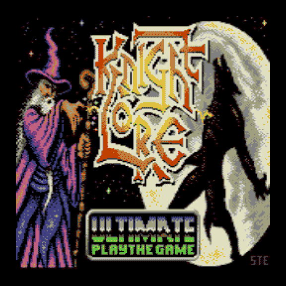
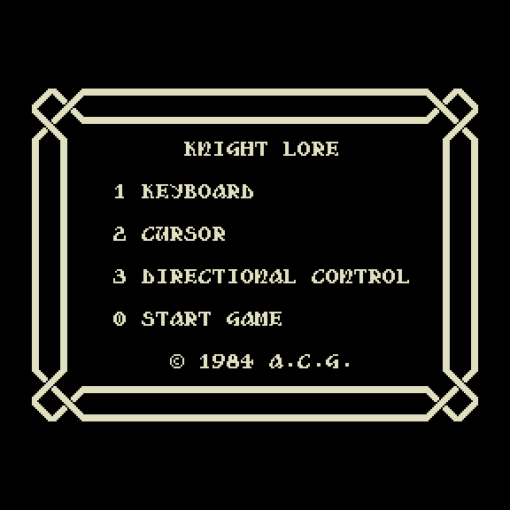
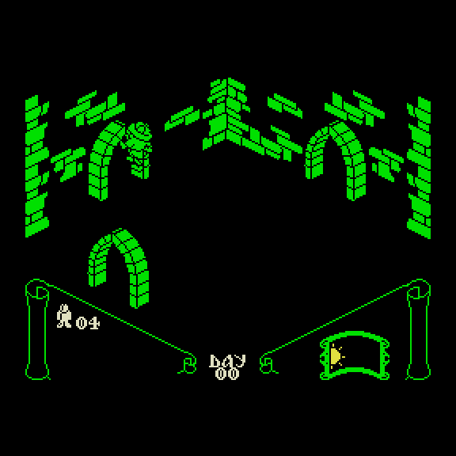
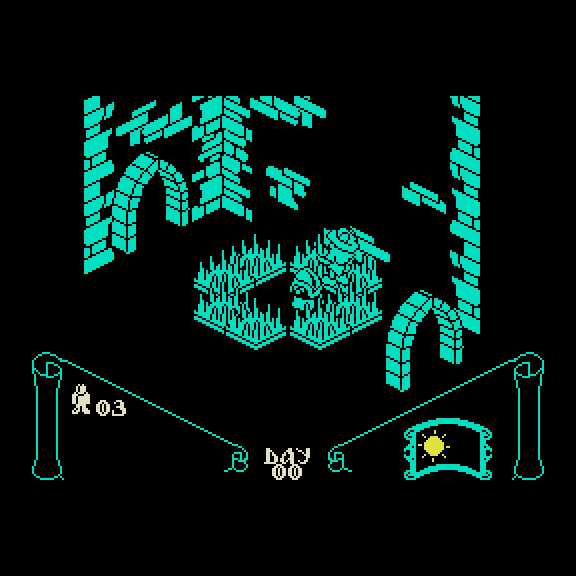
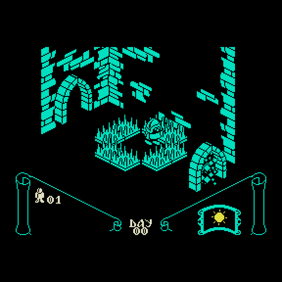
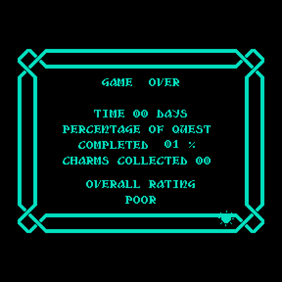

# Knight Lore — порт на Вектор-06Ц

**Knight Lore** (Ultimate Play the Game, 1984, ZX Spectrum) на ванильном **Векторе-06Ц**:
i8080 3 МГц, 64 КБ, без Z80-переходника и без квазидиска. Код игры — исходник ZX
(дизассемблер tcdev), переведённый на i8080 на уровне исходника; логика сверяется с
оригиналом ZX итерация в итерацию (локстеп), вывод, звук и ввод — свои, под Вектор.

| Заставка | Меню | Игра |
|---|---|---|
|  |  |  |

| Игра | Игра | GAME OVER |
|---|---|---|
|  |  |  |

## Готовые образы

Оба — образ памяти **с адреса 0x0000** (64 КБ, формат `.C00` / `.r0m`): на MiSTer
(ядро Vector-06C) открываются через меню ядра как `.C00`, в эмуляторах — как `.r0m`.

| Файл | Что это |
|---|---|
| [`rom/knightlore.c00`](rom/knightlore.c00) | релиз: 16-цветная заставка с мелодией, затем игра (упакована ZX0) |
| [`rom/knightlore-notitle.c00`](rom/knightlore-notitle.c00) | та же игра без заставки — сразу меню |

Из CP/M Вектора Турбо+ (`ИМЯ -V T3`) эти образы не запускаются: загрузчик CP/M кладёт
программу с 0x0100, а игре нужна и нулевая страница (загрузчик, вектор прерывания).

## Управление

В меню: **1** KEYBOARD, **2** CURSOR, **3** DIRECTIONAL CONTROL — выбор раскладки,
**0** — начать игру.

| действие | 1 KEYBOARD | 2 CURSOR | 3 DIRECTIONAL |
|---|---|---|---|
| поворот / шаг влево | O | ← | ← |
| поворот / шаг вправо | P | → | → |
| шаг вперёд / вверх | Q | ↑ | ↑ |
| вниз | — | — | ↓ |
| прыжок | A | пробел | пробел |
| взять / бросить | 0…7 | ↓ | 0…7 |

**ВК** — пауза. **Джойстик «П»** (порт 6, оба устройства) работает всегда, вместе с
клавиатурой: направления и кнопки сводятся к клавишам выбранной раскладки (огонь 1 —
прыжок, огонь 2 — взять/бросить); в меню огонь — «0 START GAME», направления листают
раскладку; на заставке огонь — как любая клавиша. Подробно — `docs/PORT_RECIPE.md` §25, §34.

**Читов в игре нет.** Бессмертие (`KLLIVES=1`) и выбор комнаты (`KLROOM`) — ключи
стендов проверки: они правят память в эмуляторе, в образ не входят.

## Сборка

Нужны Python 3 и [sjasmplus](https://github.com/z00m128/sjasmplus). В `tools/sjasmplus`
лежит сборка под macOS arm64; на другой машине — свой, путь в `SJASMPLUS`.

```sh
./build.sh roms                    # оба образа в rom/ (knightlore.c00, knightlore-notitle.c00)
SJASMPLUS=sjasmplus ./build.sh roms
```

Отдельные цели: `./build.sh vec` (игра, `build/knightlore_vec.r0m`), `./build.sh release`
(заставка + игра, `build/knightlore_title.r0m`), `./build.sh lockstep` (логика 1:1 для
сверки с ZX), `./build.sh jukebox` (стенд звука). Как устроен перевод Z80 → i8080 и
склейка — [docs/PIPELINE.md](docs/PIPELINE.md); журнал порта со всеми числами —
[docs/PORT_RECIPE.md](docs/PORT_RECIPE.md).

## Проверки

Стенды — на ядре [vector06js](https://github.com/svofski/vector06js) (клон в
`~/projects/vector06js` или путь в `V06JS`); локстеп и гейт рендера берут журналы ZX из
соседнего `../knightlore-research/zx-stand`.

```sh
./build.sh lockstep && node tools/lockstep_vec.js build/knightlore_8080.r0m build/knightlore_8080.sld 600 \
    ../knightlore-research/zx-stand/inputs_alive.txt ../knightlore-research/zx-stand/zx_states600.bin
./build.sh vec
node tools/inputcheck_vec.js build/knightlore_vec.r0m build/knightlore_vec.sld   # клавиатура, джойстик «П», пауза
node tools/kbcheck_vec.js    build/knightlore_vec.r0m build/knightlore_vec.sld
tools/logicgate.sh 1500 3,7        # логика vec против lockstep со сменой комнат
tools/render_gate.sh HEAD 200      # рендер: буфер и экран против ревизии
tools/hudsweep.sh; tools/aygate.sh # панель; пять мелодий против модели MSX
```

## Ветки

`main` — живая линия. `color-cpc`, `color-render`, `tri`, `strip` — законченные
эксперименты (цветной рендер по спрайтам CPC, цвет героя, укороченный рендер): итог
«не сошлось» по памяти или темпу, описан в журнале (§20–22, §26); в `main` не влиты.

## Откуда

Оригинал — Ultimate Play the Game, 1984. Дизассемблер ZX — tcdev (v1.00rc7) с правками
jonsole. Мелодии и звук — по MSX-версии. Порт на Вектор-06Ц — Борис Лихачёв, 2026.
